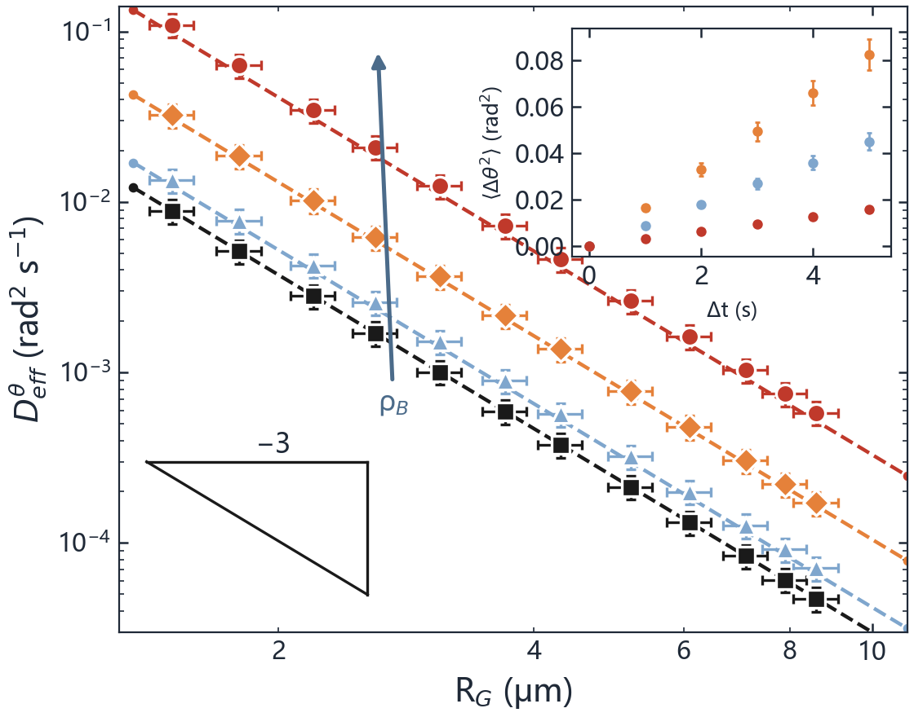
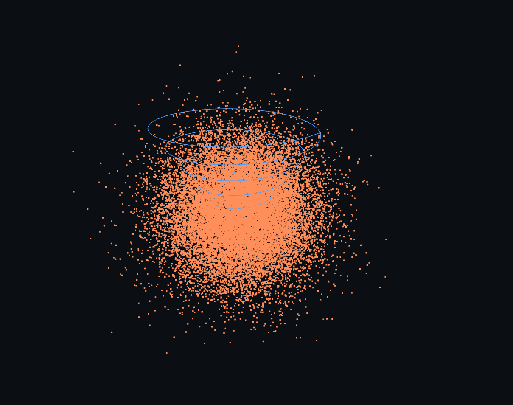
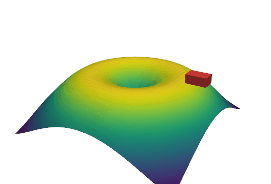
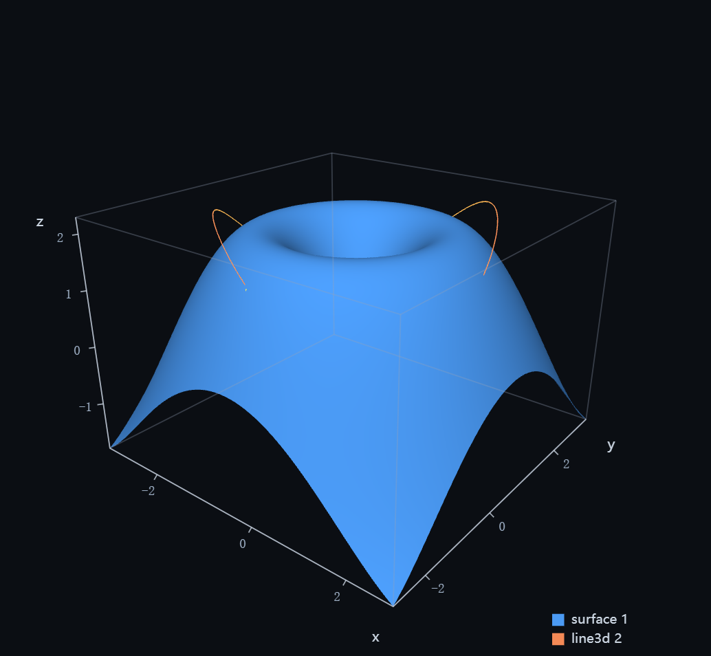
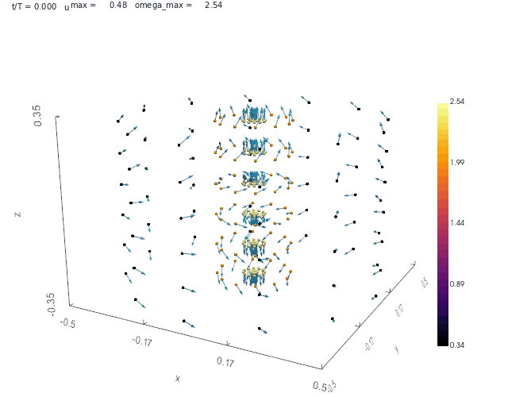
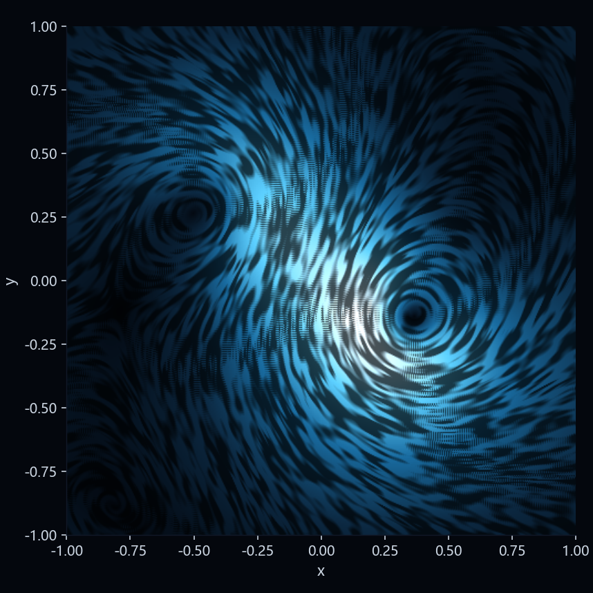

# PlotKit

<!-- UPDATE:LATEST:BEGIN -->
- 日期：2026-11-10
- 版本/ref：e2a526e
- 更新内容：N0–N6 串行完成：分支+main 远端 CI 首绿（python-tests/static-build 双绿）；contrib 拆分(G1)、PATCH 推迟(方案B)、test:ui、docs 资产逐行标注、G3 薄适配(advisory_only)、跨仓版本契约只读诊断；测试 544→556、六门禁零 violations
- 证据：docs/N0_REMOTE_FIRST_GREEN_2026-11-09.md §13–§14、docs/N6_CROSS_REPO_CONTRACT_2026-11-10.md
- 完整记录：[docs/UPDATE_LOG.md](docs/UPDATE_LOG.md)
<!-- UPDATE:LATEST:END -->

一套 **spec 驱动的绘图层**：Python 侧注册数据、定义呈现，**matplotlib 负责渲染**，网页前端只做集中呈现与编辑。

> **2026-10-31 架构变更（D33）**：渲染统一走 matplotlib，plotly 后端退役（新能力一律 mpl）。交互方式改为「拖动时前端变换 PNG，停手 120 ms 回后端重绘」（D34）。
> **注意（D37）**：netlab 的原生时间序列/示波器/李萨如/相图与分析面板**保留不删**，PlotKit 与它长期并存——不存在「替换掉旧画布」这一步。

- **一份 spec 一条渲染路径**：matplotlib 出 PNG/SVG，网页呈现与论文出图同一套代码
- **数据即命名**：`add_data("v_out", arr, unit="V", role="series")`，绘图只引用名字，不搬数组
- **两种书写习惯**：`fig.add_plot(kind, x=, y=)` / `fig.add_trace({...})` / `ax.plot(x, y)` 三条入口产出**同一份 spec**
- **零 CDN**：渲染在后端完成，前端不引任何外部脚本，断网可用
- **三种展示出口**：Jupyter 内联 → PySide6 原生窗口 → 系统浏览器（自动探测，可强制）

> 设计口径见 [docs/DESIGN_v0.md](docs/DESIGN_v0.md)（早期 D1–D23）与 [docs/REQUIREMENTS_AND_PROGRESS.md](docs/REQUIREMENTS_AND_PROGRESS.md)（现行 D1–D38，含 D33 架构变更）。

## 安装

```bash
pip install plotkit                    # 最小：numpy + matplotlib + pillow
pip install "plotkit[web,three]"       # 加浏览器界面与三维（PyVista/VTK）
pip install "plotkit[all]"             # 全量

plotkit doctor                         # 装完先体检：版本、可选功能、已知不兼容
```

从源码开发：`pip install -e ".[all,dev]"`。

更新 / 卸载 / 依赖版本兼容 / 离线安装 / WSL 与 Linux 注意事项，见 **[docs/INSTALL.md](docs/INSTALL.md)**。

## 三分钟上手

```python
import numpy as np
import plotkit as pk

t = np.linspace(0, 1, 2001)
fig = pk.figure(title="RC 充电", theme="netlab-dark")

fig.add_data("t", t, unit="s", role="coord")
fig.add_data("v_out", 5 * (1 - np.exp(-t / 0.2)), unit="V", role="series")

fig.add_plot("line", x="t", y="v_out", label="V_out")
fig.set_view(0, xlabel="t / s", ylabel="V / V")
fig.show()          # 自动选出口；fig.show(sink="browser") 可强制
```

同样的图，三种写法：

```python
fig.add_plot("line", x="t", y="v")          # 1) 数据名
fig.add_plot("line", x=t, y=v)              # 2) 直接给数组（自动注册成匿名单）
fig, (ax,) = pk.subplots(1, 1)              # 3) matplotlib 习惯
ax.plot(t, v); ax.set_xlabel("t / s")
```

## 常用出口

| 出口 | 调用 | 说明 |
|---|---|---|
| 浏览器 | `fig.show(sink="browser")` | 起本地服务，开默认浏览器，阻塞到 Ctrl+C |
| 原生窗口 | `fig.show(sink="window")` | PySide6 + QtWebEngine；VS Code 里跑不会跳浏览器 |
| Notebook | `fig.show()` | 有 IPython 时自动内联 iframe |
| 静态图 | `fig.savefig("x.png", dpi=200)` | matplotlib 后端，论文/报告用 |
| 单文件 HTML | `fig.html()` | 内联 matplotlib SVG，零 JS、零 CDN，可直接发给别人 |

> 需求 · 决策 · 进度 · 经验（单一入口）：[docs/REQUIREMENTS_AND_PROGRESS.md](docs/REQUIREMENTS_AND_PROGRESS.md)

## 目录

```
src/plotkit/
├─ spec/        model（spec 数据类） / validate（一次收齐全部错误） / io（原子写、逐字节稳定）
├─ store/       registry（命名数据集、append/replace、history） / reclaim（引用计数+待回收区）
│                downsample（min-max 包络、LTTB） / disk（分块 float32 落盘）
├─ backends/    registry（LayerSpec + builders） / dispatch（选后端） / series（公共件）
│                mpl_backend / pyvista_backend（可选三维） / livecache（热重绘）
├─ api/         native（Figure） / mpl_proxy（ax.plot 风格代理）
├─ server/      app（REST + 二进制序列） / live（后台线程 uvicorn） / assets（静态资源定位）
├─ runtime/     sink（三出口探测） / window（QtWebEngine 窗口）
├─ desktop/     pywebview + WebView2 桌面壳（D39）
└─ static/      index.html / app.css / app.js（由 app.ts 经 esbuild 构建，产物已提交）
```

## 数据层约定

- `add_data(name, values, unit="", role="auto", tags=(), life="append")`
- `role`：`coord`（x/时间）/ `series`（y）/ `field`（网格）/ `table` / `image`；绘图绑定时校验，不匹配直接报错
- `life="append"`：`push()` 追加，历史可回看；`life="replace"`：只保最新（实时量用）
- 超过热窗/配额走 `Reclaimer` → 待回收区（可撤销），不会静默丢数据
- 库只管**可视化依赖**的数据；业务数据仍由你的程序自己保存

## 测试

```bash
PYTHONPATH=src python -m pytest -q     # 470 passed
```

真实渲染自检（需要本机 Edge/Chrome 或 PySide6）：

```bash
PYTHONPATH=src python tools/dev_serve.py --port 8791     # 起一个带样例数据的页面
```

## 论文级出图（v0.2）

同一份 spec，浏览器看结构、matplotlib 出正式图。已支持：

- 双对数轴 + `view.loglabels="plain-x"`（对数轴直接标 2/4/6/8/10，而不是 2×10⁰）
- 方向误差棒（`data.error_x/y`，对称/非对称，`style.error.width` 是端帽宽度）
- 内侧刻度 + 四周镜像 + 次刻度（`view.ticks={inside,mirror,minor}`）
- 逐级字号（`figure.fonts={title,axis,tick,legend,annotation}`）
- 数学排版：`$R_G$`、`$\Delta	heta^2$` 这类写法在 mpl 走真正的 mathtext，在浏览器降级成 `<sub>/<sup>`
- 装饰：斜率参考三角、箭头、线段、矩形、路径（`fig.add_shape(...)`，不参与 autoscale）
- 内嵌子图：`fig.add_inset(1, parent=0, rect=(x,y,w,h))`，浏览器里**直接拖框移动、拖右下角改大小**，松手写回 spec
- 图例按 `layer.legend` 过滤（拟合线可以不进图例）

完整样例（论文 panel b）：

```bash
PYTHONPATH=src python examples/paper_panel_b.py            # 出 docs/paper_panel_b.png
PYTHONPATH=src python examples/paper_panel_b.py --serve    # 浏览器交互版
```



## 交互与布局（v0.2）

- **菜单栏**：文件（保存 spec.json / 导出 PNG / 重载）、编辑（撤销 / 重做 / 复制图层 / 删除图层）、插入（新建图层 / 新建分组 / 加内嵌图）、视图（收面板 / 切主题 / 展开全部）。
- **快捷键**：`Ctrl+Z` 撤销、`Ctrl+Y`（或 `Ctrl+Shift+Z`）重做、`Ctrl+D` 复制图层、`Delete` 删除、`Ctrl+S` 存 spec.json、`Ctrl+E` 导 PNG、`Esc` 收菜单。
- **图层分组**：插入 → 新建分组，把图层行拖到分组标题上即可归组；双击标题改名，`✕` 解散。
- **布局持久化**：面板宽度、各分组折叠状态、展开的图层、图层分组存在 **`layout.json`**（`GET/PUT /api/layout`，原子写，上限 64 KB）。归属规则：spec 决定"图长什么样"，layout 决定"软件怎么摆"。
- **撤销语义**：前端保存最近 50 次**已提交**的 spec 快照，撤销/重做都是整份 PUT 回后端，不引入新协议。

## 嵌进宿主程序（netlab 已在用）

PlotKit 可以当成一个**子应用**挂到任何 FastAPI 程序上，宿主只负责往里推数据：

```python
from plotkit.server.app import create_app
app.mount("/plotkit", create_app(figure))        # 注意：要挂在 /static 之后
```

三条约定（都踩过坑，改代码前先读）：

1. **前端全部用相对路径**（`<base href="./">` + `api/...`），否则挂到 `/plotkit` 后绝对路径会打到宿主的 `/api`。
2. **静态资源的 `no-store` 中间件要按 `"/static/" in path` 判**，不要用 `startswith("/static")`——挂载后 `request.url.path` 是 `/plotkit/static/app.js`。
3. **`?embed=1`** 是给宿主内嵌用的紧凑形态：顶栏收纳品牌与标题、菜单不换行、右侧面板默认收起、无横向滚动条。

netlab 里的用法（`NetlabHome/netlab/plotkit_bridge.py`）：每 200 ms 拉一次仿真增量帧，把每个探针通道写成命名数据集（`n:<节点>:<字段>` → `signal·voltage`），新通道自动建图层，场景重置时清空历史重建；前端是「分析 → 绘图」子页签 + 可**停靠/分离**的非模态浮窗（`/plotkit/?embed=1`）。

## 时间窗与回放（v0.3）

对齐 netlab 老画布的那条工具栏，做成了 PlotKit 自己的能力：

| 控件 | 行为 | 归属 |
|---|---|---|
| 时间窗（秒） | 只保留最近 N 秒的数据再构图（不是"缩放"，是真的少传/少画） | spec `figure.window` |
| 回放滑杆 | 游标往回拖 → `GET /api/figure.json?t=<游标>`，后端截出「游标往回 N 秒」 | 前端 L3，不进 spec |
| ▶ / 速度 / 循环 | 速度 = 每秒多少帧，一帧 = 一个采样点；按真实时间前进，重绘被降频也不会变慢 | 前端 L3 |
| 回到实时 | 游标置空，重新跟着最新数据走 | 前端 L3 |
| 清空 | `POST /api/clear`：图层清空、数据集归零（宿主继续推就重新长出来） | 后端 |

```python
fig.window(5.0)                 # 只显示最近 5 秒；fig.window(None) = 全部历史
fig.render(t_end=12.5)          # 回放游标：截 7.5–12.5 s 这一段
```

`GET /api/meta` 会带 `time: {min, max, count}`（回放滑杆的范围与帧数）和 `window`。

## 示例：生物质能小车多物理场仿真

`projects/teg_car/teg_car_sim.py` 是一个自包含的工程示例（独立文件夹，不参与库代码）：热—电—机械—转向四域耦合的
小车仿真，一次跑出 37 张图（含 6 张真算的三维场、整车装配图）+ 600 帧三维动画
`29_animation_3d.gif`，外加 `projects/teg_car/figures/REPORT.md`。

```bash
PYTHONPATH=src python projects/teg_car/teg_car_sim.py            # 约 75 s（含 12×12=144 组扫描）
PYTHONPATH=src python projects/teg_car/teg_car_sim.py --quick    # 约 33 s，6×6 扫描
PYTHONPATH=src python projects/teg_car/teg_car_sim.py --stress   # 瞬态跑满 100 万步
```

除了四域耦合，它还覆盖了工程上真正吃算力的几块，并且都是**真算**（不是贴图）：

| 项目 | 规模 | 实测 |
| --- | --- | --- |
| 均温板稳态导热（稀疏有限差分） | 5.1 万节点 | 0.9 s |
| 散热片通道对流-扩散（上风 + 稀疏求解） | 10 万单元 | 2.6 s |
| 散热板三维共轭传热（SOR + 三维对流-扩散） | 12.6 万单元 | 0.2 s |
| 底盘梁有限元 | 4 万自由度 | 0.25 s |
| 瞬态耦合（RK4，四状态） | 20 万步 | 6.7 s（约 3 万步/秒） |

散热板还做了**三维矢量热传递**：矩形通道泊肃叶速度场（Re=568）与三维温度场一起解，
出口体均 33.7 °C、带走 1.71 W，热流矢量 q = −k∇T 在截面上从两侧翅片指向中心
（`35/36/37` 三张图）。

两种赛制分别建模（初赛温差发电直接驱动 107.3 m / 决赛超级电容 121.8 m），
TEG 还支持沿流向分 8 段（状态数 18）看分布参数效应：迎火面 98 °C、背火面 74 °C。

它同时是规模压测：100 万点 × 3 通道入库 9 ms、M4 抽稀 24 ms、冷渲染 273 ms、峰值 42 MB。

## NS 涡旋：两种数据源

| 模式 | 数据来源 | 启动 |
| --- | --- | --- |
| A′ 解析 | 前导阶自相似解（瞬时、可调剖面 `h/X₀/η₀`） | `python -m plotkit.ns.app` |
| B 数值 | 自研伪谱求解器（32³，2/3 去混叠 + 投影，首次约 15 s） | `python -m plotkit.ns.app --source solver` |

```python
# 也可以把 NS 接口挂进自己的二维应用（同一个 FastAPI 进程）
from plotkit.server.app import create_app
app = create_app(figure, with_ns=True)     # 多出 /api/ns/*
```

### 任意三维流场 → 一张图（`pk.field3d`）

只要实现一个方法 `velocity(points, t) -> (N,3)`，就能拿到体积 + 粒子 + 流线三层：

```python
class MyField:
    bounds = ((-1, -1, -1), (1, 1, 1))
    def velocity(self, points, t):
        return ...                      # (N, 3)

fig = pk.field3d.scene(MyField(), t=0.0, layers=("volume", "particles", "streamlines"))
fig.render(width=900, height=700, backend="pyvista")
```

`pk.ns.scene.figure()` 现在就是它的薄封装；`pk.ns.ArrayField(npz)` 可从规则网格数据加载。

### 批量渲染（三维并发）

```bash
curl -X POST localhost:8750/api/render3d/batch   -H 'content-type: application/json'   -d '{"width":800,"height":600,"workers":4,"frames":[{"spec":{...}},{"spec":{...}}]}' -o frames.zip
```

二维帧走进程内 mpl，三维帧走 `pyvista_pool` 多进程（逐字节一致）；`frames` 上限 600，少于 8 帧会自动退化成串行。命令行等价物：`plotkit render3d --payload frames.json --out frames.zip`。

### 多段折线（`segments`）

流线束、轨迹束这类"很多段短线"用 `segments`：`x/y/z` 是**端点点对**（第 2i、2i+1 连成一段），
主查看器用 `gl.LINES` 画，服务端 `/api/segments` 走与 `/api/particles` 相同的 `PK01` 二进制帧。

```python
fig.add_data("sx", xs); fig.add_data("sy", ys); fig.add_data("sz", sz)
fig.add("segments", {"x": "sx", "y": "sy", "z": "sz"}, style={"width": 1.0, "color": "#73dbff"})
```

## 三维视图（点云/曲面/体积/粒子，见 [docs/WEB3D_LAYERS.md](docs/WEB3D_LAYERS.md)）

页面右上角「3D」按钮：把带 `z` 的图层（`scatter3d` / `line3d` / `stream3d`）交给 WebGL2 直接画，
拖动只改 MVP 矩阵、不请求服务端（实测 25k 点 120 fps）。数据走 `GET /api/xyz` 的二进制帧
（`magic + meta_len + n + json + float32(x,y,z)`），前端把 buffer 原样上传成顶点缓冲。



曲面（`surface` / `trisurf` / `voxels` / `heatmap` / `contourf`）走另一条路：`GET /api/mesh` 回
「顶点 + 法线 + 三角形索引」的二进制帧，前端做 Lambert 着色（环境光 0.3 + 漫反射 0.7）。


二维那边同时补了「拖动中低清预览」（每 70 ms 一次半分辨率请求）与「服务端 hover 拾取」
（`GET /api/pick` 返回最近的真实数据点，而不是从像素反推）。

### 三维 NS 涡旋可视化（模式 A-prime）

`python -m plotkit.ns.app` 打开一个 WebGL2 页面：真实前导阶自相似 Navier–Stokes 涡旋场，体积渲染 + 螺旋粒子 + 轨迹，左侧双轨诊断（解析连续场 / N³ 网格），顶部公式，右侧三个旋钮（`h`、`X₀`、`η₀`）实时改场。

- 场：`plotkit.ns.SimilarityField`（相似坐标 `r=√(2qX)`、`z=q^{1/2-h}η`，标度 `‖u‖∞~τ^{-(1/2+h)}`、`‖ω‖∞~τ^{-1}`）
- 诊断：`plotkit.ns.analyze` / `grid_stats` / `convergence`
- 接口：`/api/ns/{meta,field,slice,velocity,pathlines,diagnostics,convergence,formula.svg}`，二进制帧 `PKNS + meta_len + meta + float32`
- 实测：1280×820 窗口 **98–120 fps**，24 000 粒子，不可压残差 2.1–2.5%

详细推导、决策与限制见 [docs/NS_VORTEX.md](docs/NS_VORTEX.md)。**它不是爆破解**，界面常驻标注 `Mode A-prime - Leading-order similarity field (not a verified blow-up solution)`。

## 三维动画（`figure.anim3d()`）

三维不能像二维那样"改数据再整图重画"——每次新建 Plotter 都要重建 OpenGL 上下文
（实测 450–600 ms/帧）。所以动画 API 复用**同一个**离屏窗口，逐帧只改 actor 的
位置与朝向，成本回到 10–30 ms/帧：

```python
anim = fig.anim3d(frames=60, fps=20, width=560, height=380)   # fig 里已有 surface 图层
car = anim.add_box("car", size=(0.7, 0.45, 0.3), color="#ef4444")
anim.set_pose(car, poses, heading=np.degrees(theta))          # (frames,3) + (frames,)，弧度也认
anim.add_trail("path", poses)                                 # 轨迹逐帧生长
anim.orbit(azim=(-60, 60))                                    # 相机扫一圈（可选）
anim.save_gif("car.gif")                                      # 不依赖 ffmpeg；save_mp4() 才要
```

60 帧 560×380 实测 **2.33 s（38.8 ms/帧）**，GIF 1.4 MB：



### 三维视图里的装饰、区域分析与时间轴

浏览器里的 3D 视图不是"只能转的点云"，三件事都在前端做完了：

- **装饰**：包围盒棱、三轴、1/2/5 刻度、轴名、标题、图例由 2D canvas 叠在 WebGL 上画
  （`view3d.js` 的 `attachOverlay`），所以缩放窗口时文字始终清晰、不进显存。
- **框选区域分析**：按住 Alt 拖一个框，前端把当前 MVP 矩阵发给 `POST /api/region`，
  服务端把点投到 NDC 后筛选，返回选中点数与 x/y/z 的 min/max/mean/p05/p95
  （100 万点约 5–10 ms）。
- **时间轴**：图层带 `data.t` 时出现底部滑条，`GET /api/timeline` 把
  `(x,y,z,t)` 重采样成 240 帧，拖动即时定位、▶ 以 20 fps 播放，marker 走、轨迹逐帧生长。

```python
fig.add_data("t", tt); fig.add_data("x", px); fig.add_data("y", py); fig.add_data("z", pz)
fig.add("line3d", {"x": "x", "y": "y", "z": "z", "t": "t"})   # 带 t 才有时间轴
```



**要真矢量就别用 PyVista**：VTK 的 GL2PS 导出在本机（9.7.1 + OpenGL2）只剩位图，所以
`fmt="svg"` 时调度层一律回退 matplotlib（surface 600×420 → 161 KB、890 个 `<path>`）。

## 示例：纳维–斯托克斯方程的爆破解（三维矢量动画）

`examples/ns_blowup.py` 用非定常 Burgers 涡——**Navier–Stokes 的精确解**——做有限时间爆破：

```
δ²(t) = (1 - t/T)·[δ₀² - 2νT·ln(1 - t/T)]      ω_max = Γ/(2πδ²) ~ 1/(T - t)
```

60 帧三维矢量场（箭头 = 速度方向，颜色 = 涡量），涡管一边被轴向拉伸一边收缩到细丝，
涡量从 2.55 涨到 84.8。复现：`PYTHONPATH=src python examples/ns_blowup.py`（约 40 s）。



## 矢量场：LIC 纹理与体渲染

`quiver` 只能抽几十根箭头，稠密的涡与剪切层会被抽没。两个新图层解决这件事：

```python
fig.add("lic", {"x": "x", "y": "y", "u": "u", "v": "v"},
        style={"cmap": "ocean", "steps": 24, "contrast": 1.9})     # 二维切片，纹理沿流线拉丝
fig.add("volume", {"x": "x", "y": "y", "z": "z", "values": "w"},
        style={"cmap": "inferno", "opacity_ramp": [0, 0, 0.02, 0.1, 0.4, 0.8]})  # 三维，仅 pyvista
```



`lic` 用"沿流向反复模糊"近似线积分卷积：460×460、`steps=22` 约 1.2 s，纹理走向就是流线，
颜色仍由速度大小决定。`volume` 走 VTK 的体渲染（半透明发光体），比等值面更能看清涡管内部。

## 性能（2026-10-31 实测，1200×700 / 6 通道 × 2 万点）

| 指标 | 实测 | 说明 |
|---|---|---|
| 冷导出 PNG | **111 ms** | `fig.render()`，含 M4 抽稀 + matplotlib 绘制 + PNG 编码 |
| 热重绘（固定视窗，blit） | **41–48 ms** | 持久 Figure + 只重画数据 artist；PNG 编码约 33 ms 是地板 |
| 抽稀 200 万点 | **9 ms** | M4 包络，保尖峰、保 float32 |
| 追加 2000 次 × 1000 点 | **35 ms** | 几何扩容缓冲（旧实现 4706 ms） |
| 三维 10 万点（PyVista） | **196 ms** | 同规格 matplotlib `Axes3D` 是 1319 ms |
| 批量三维 40 帧（4 进程） | **8.9 s** | 串行 17.4 s；8 帧时反而更慢（worker 启动 ~2 s） |
| 抽稀 300 万点（金字塔） | **3.2 ms** | 无金字塔 7.3 ms；端到端只占 <5% |

完整表格与复现命令见 [docs/BENCHMARKS.md](docs/BENCHMARKS.md)（`tools/bench_regress.py --check` 可当回归门禁）。

## 当前状态

- ✅ P0 spec / P1 store / P2 双后端（plotly 已退役）/ P3 API + 服务 + 前端（124 项测试，真实浏览器渲染已核对）
- ✅ P13-00 mpl 渲染管线：`/api/render`（像素尺寸 + xlim/ylim + 回放游标）、ETag/304 缓存、前端图像层（拖动变换 + 停手 120 ms 重绘 + hover 读数）、presets / `fig.add()` / strict（250 项测试；1200×700×6×20k 实测 ~310 ms，目标 <120 ms 待优化）
- ✅ v0.2 论文级能力：误差棒、对数轴朴素标签、刻度样式、逐级字号、装饰、内嵌子图 + 拖拽
- ✅ v0.2 交互：撤销/重做、图层分组、菜单栏 + 快捷键、`layout.json`、构图缓存 + GZip（**115 项测试**）
- ✅ P5 接 netlab：分析组「绘图」子页签 + 可停靠/分离内嵌窗口（netlab 侧 **347 项测试**）
- ⏳ P4 延迟：热重绘 14–23 ms，冷启动 862 ms（门槛已改为「热重绘 <50 ms + 冷启动 <1 s」）
- ⏳ P6 删旧：netlab 的时间序列 canvas 仍在，等 PlotKit 补齐回放/预计算/多画布后再删
- ✅ 动画：`fig.set_anim(frames=40, fps=20)` → `/api/anim` 出 GIF，前端「动画」按钮播放
- ✅ **MultiPlotter 的 18 种 kind 全部实现**（11×2D + 7×3D），另有 11 种附加 kind（contourf/correlation/barbs + boxplot/violinplot/ecdf/hexbin/barh/stackplot/step/stem）；见 **[docs/REQUIREMENTS_AND_PROGRESS.md](docs/REQUIREMENTS_AND_PROGRESS.md) §3**（票单 P13-00…08）
