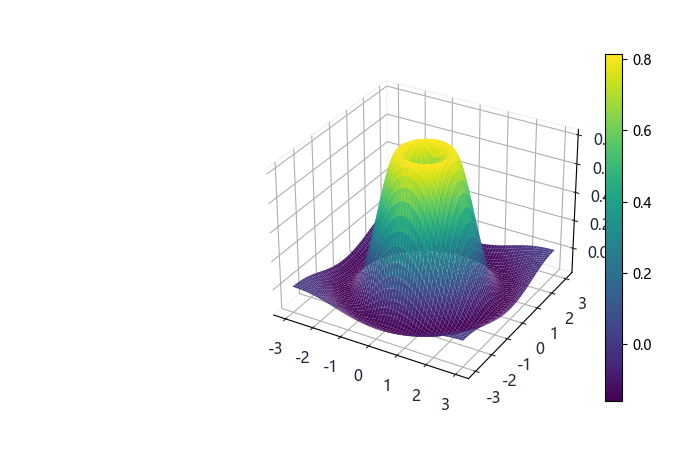
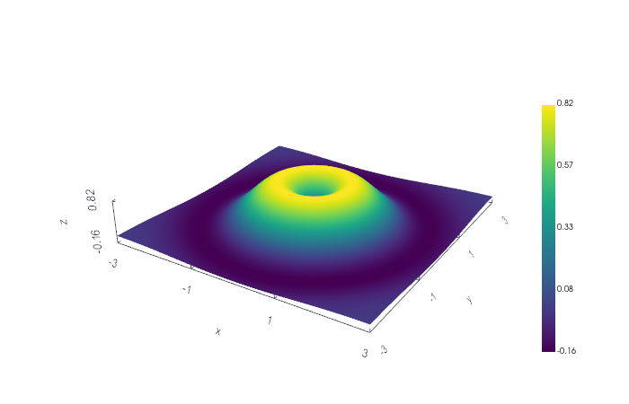
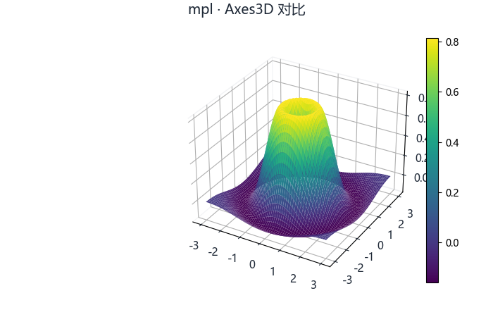
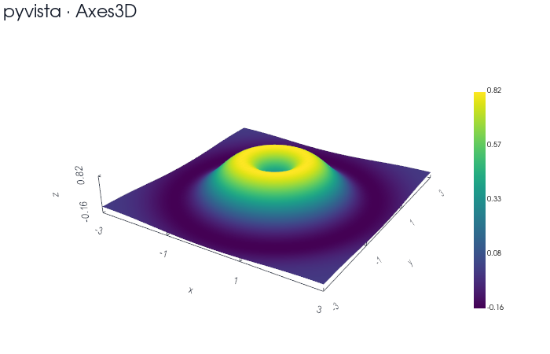

# 三维与大规模后端选型评估（PyVista / VisPy / Trame）

> 2026-10-31 评估（**最后更新：2026-11-06** 校对）。评估时生产代码为 Matplotlib 单后端（D33）；D38 后已接入可选 PyVista 后端（`src/plotkit/backends/pyvista_backend.py`，见 §10），matplotlib 仍为默认与兜底。
> 依据：本仓库代码核查 + 本机实测基线 + 三个上游仓库的官方源码/文档。

## 1. 结论（TL;DR）

| 后端 | 定位 | 结论 |
|---|---|---|
| Matplotlib（现状） | 默认、2D 论文图、静态导出、回退 | **保留**，不替换 |
| PyVista / VTK | 可选 3D 工程后端：网格、体场、矢量场、点云 | **值得接入**，做成可选依赖 |
| VisPy | 超大动态点线（百万级、逐帧更新） | **预留**，只在实测撞墙后引入 |
| Trame | 浏览器三维交互的传输/会话层 | **只做交互层**，不是绘图后端 |

一句话：**接 PyVista 是为了"画得对、画得像"，接 VisPy 是为了"画得动"，Trame 只解决"怎么在浏览器里转起来"。三者都不能直接复用现有的 `Axes3D` drawer。**

## 2. 现状与实测基线

当前 3D 链路：`spec.layers` → `mpl_backend.to_figure()`（`projection="3d"` 的 `Axes3D`）→ Agg 栅格化 → PNG。
相关代码：`src/plotkit/backends/mpl_backend.py:637`（`_surface_grid`）、`:658`（`_draw_surface`）、`:1280`（`_draw_voxels`）、`:852`（`stream3d` 的 RK2，实为 `stream3d_paths()`）。

本机实测（800×600，`PLOTKIT_RENDER_CACHE=0`，冷渲染，p50）：

| 场景 | 规模 | 冷 PNG |
|---|---|---|
| `surface` | 30×30（900 单元） | 154ms |
| `surface` | 60×60（3.6k） | 259ms |
| `surface` | 100×100（10k） | **619ms** |
| `scatter3d` | 10k 点 | 302ms |
| `scatter3d` | 50k 点 | 978ms |
| `scatter3d` | 100k 点 | **1969ms** |
| `voxels` | 15³ | 747ms |
| `voxels` | 25³ | 2218ms |
| `voxels` | 35³ | **4322ms** |

对照：同机 2D 冷导出（6ch×20k，1200×700）只要 **111ms**（见 [BENCHMARKS.md](BENCHMARKS.md)）。
即：**三维在 1 万单元/5 万点这个量级就已经比整张 2D 大图慢一个数量级**，且完全靠 CPU 栅格化。

## 3. 官方事实（逐条有源）

**PyVista**
- 版本门槛：`requires-python = ">=3.11"`，依赖 `vtk>=9.3.1,<9.8.0`（排除 9.4.0/9.4.1）。本仓库 `pyproject.toml` 目前是 `>=3.10` → **接入前必须抬门槛或锁旧版**。
- 离屏出图：官方示例用 `pv.Plotter(off_screen=True)` + `pl.show(screenshot=...)`，`pl.image` 是 `numpy.uint8` RGBA，可 `imshow`。→ 静态 PNG 出口是成熟的。
- 抗锯齿：MSAA 默认 8 samples，另有 SSAA/FXAA。→ 曲面/网格质量明显高于 `mplot3d`。
- 无头风险：Plotter 源码对"没有 X server"有显式告警，EGL/OSMesa 依 VTK 版本而定。→ **必须在目标服务器上单独验证，不能拿本机 Windows 桌面环境代表部署环境**。
- 数据模型：几何 + 拓扑，点/单元数组存在 VTK buffer 里；NumPy 互操作好，但存在 `deep_copy=False` 这类"借用"路径，所有权必须写清楚。

**VisPy**
- 自述："high-performance interactive 2D/3D data visualization library…leverages GPUs through OpenGL to display very large datasets"（`vispy/__init__.py`）。→ 定位就是大数据量 GPU 绘制。
- 代价：色标、图例、坐标轴、体数据、PNG 截图、Web 场景生命周期都要自己做。→ 不是"换后端"，是"换一层"。

**Trame**
- 自述：以 VTK/ParaView 为核心，"exposes both local and remote rendering through a single method"，Apache-2.0。
- 它是**应用框架**（state 同步 + WebSocket + 前端组件），不是渲染器。→ 只能挂在 PyVista 场景外面。

## 4. 逐 kind 兼容性映射

| PlotKit kind | PyVista 映射 | 兼容性 | 风险点 |
|---|---|---|---|
| `surface` | `StructuredGrid` / `PolyData` | 高 | `x/y` 一维时需 meshgrid，二维时需与 z 同形（现有校验可复用） |
| `trisurf` | `PolyData`（三角面） | 高 | 需显式写三角形拓扑 |
| `scatter3d` | `PolyData` 点集 + glyph | 高 | 点大小/深度/颜色语义需重新定义 |
| `line3d` | `PolyData` line | 高 | 无 |
| `quiver3d` | 箭头 glyph | 中高 | `length/normalize` 需映射到 glyph 参数 |
| `bar3d` | cube glyph | 中 | **不能逐柱建 Actor**，必须单 Actor 多实例 |
| `hist3d` | `np.histogram2d` 结果 + glyph | 高 | 算法可保留，只换绘制 |
| `voxels` | `ImageData` + threshold/volume | 中 | 需定"全画"还是"按阈值/等值面" |
| `stream3d` | VTK stream tracer | 中 | **结果不与现有 RK2 逐点一致**，见 §5 |
| `stem3d` | 线段集合 + 点 glyph | 中 | 需自行组装 |
| `text3d` | VTK 文字/标签 | 中低 | 字体、遮挡、布局差异大 |

## 5. 三个必须先定死的兼容边界

1. **`LayerSpec` 的单 builder 撑不住三后端**
   评估时（D38 前）`LayerSpec` 只有单个 `builder: Builder | None`（签名 `(layer, store)`，产出 matplotlib artist）；D38 后已改为 `builders: Mapping[str, Builder]`（见 §10.1）。
   多后端需改成 `builders: Mapping[str, Builder]`（键 `mpl` / `pyvista` / `vispy`），或另设"后端能力表"。**不要伪造一个假 ax 去复用 mpl drawer**——这正是当年拒绝 MultiPlotter `draw_handler(ax, config)` 契约的理由。

2. **float32 不能被悄悄升成 float64**
   `mpl_backend._xyz_arrays()` 统一 `dtype=float`，三维数据会翻倍内存。适配层必须"保留输入 dtype"，只在确实需要时提升。

3. **`stream3d` 算法版本必须显式化**
   现有实现是自有 RK2（网格最近点索引 + 定步长）。VTK stream tracer 的种子点、插值、步长、最大传播长度都不同 → **同 spec 会得到不同曲线**。
   方案：spec 增加 `style.algorithm = "plotkit_rk2" | "vtk"`，默认保持 `plotkit_rk2`，否则老图会"突然变了"。

另：VTK / GPU 对象必须**显式关闭**（`plotter.close()`），且必须持有数组所有权（不能借用会被 `DataStore.push` 替换掉的切片），否则是难查的崩溃/花屏。

## 6. 建议架构

```text
PlotKit spec + DataStore            （公共语义，不动）
            │
     RendererSelector               （按 kind/dimension/规模/显式 style.backend 选路）
      ┌─────┼──────────┐
   matplotlib  pyvista   vispy
   2D/论文图   3D网格体场  百万级动态点线
            │
     RenderResult               （PNG/RGBA bytes + limits + 后端名 + 缓存键）
            │
     Trame adapter（可选）       （PyVista 场景 → 浏览器 canvas）
```

对外 API 不变：`fig.render(...)` 仍返回 PNG bytes。新增的只是：
- `style.backend = "auto" | "mpl" | "pyvista" | "vispy"`；
- 环境变量/extra 控制可选依赖（`pip install plotkit[three]`）；
- `RenderResult.backend` 便于前端提示"此图由 PyVista 渲染"。

## 7. 实施顺序（建议）

1. **接口先行**（不改渲染）：`RenderResult`、`builders` 表、后端选择器、可选依赖开关；mpl 走新接口但行为不变，测试全绿。
2. **PyVista POC**：只做 `surface` / `scatter3d` / `trisurf` / `voxels` 四种，离屏 PNG，与 mpl 版做像素尺寸/色标/相机一致性测试。
3. **补齐** `quiver3d` / `bar3d` / `hist3d`，`stream3d` 加 `algorithm` 开关。
4. **规模对照基准**：10 万点、100 万点散点，100³ 体数据，PyVista vs mpl，记录冷/热与峰值内存。
5. **VisPy**：只有在第 4 步显示"百万级动态更新"确实不可行时才引入，且只做点/线两类。
6. **Trame**：只在需要"浏览器里转三维"时接，作为可选会话层。

## 8. 验收指标（写进基准脚本）

- 静态：`surface 100×100 ≤ 150ms`、`voxels 35³ ≤ 400ms`、`scatter3d 10 万 ≤ 400ms`（PyVista，离屏 PNG）。
  - 实测（`tools/bench_3d.py --check`，预热后 p50）：surface 100² **125ms**、scatter3d 10 万 **196ms**、voxels 35³ **155ms** —— 三项全部达标，且已写进 `BUDGET_MS` 当门禁。
- 交互：Trame 场景拖动 ≥ 20fps（本机 RTX 4060 Laptop）。
- 内存：PyVista 场景关闭后 RSS 回到基线 ±10%（防 VTK 泄漏）。→ **实测做不到**，见 §10.4 的修正口径。
- 兼容：同一 spec 在 mpl 与 pyvista 下 `limits` 覆盖同一份数据；`stream3d` 默认算法结果与今天逐点一致。
  - 注：两边 `limits` **不追求数值相等**——mpl 报的是 autoscale 后的显示范围（含 5% 边距，3D 还受投影影响），pyvista 报的是数据 bounds。实测同一份 −2..2 的曲面：mpl `xlim≈[-2.29, 2.29]`、pyvista `xlim=[-2.0, 2.0]`。

## 9. 不做清单

- 不做"全局替换 mpl 3D"。
- 不在 PyVista 上复刻 matplotlib 的 `Axes3D` 语义（spines/刻度/论文排版）。
- 不承诺 SVG 从 PyVista 导出（VTK 无矢量输出，只能光栅）。
- 不在未验证 EGL/OSMesa 的服务器上默认启用 PyVista。
- 不把 VisPy 当通用后端。

---

## 10. 实现记录（D38，2026-10-31）

多后端框架已落地，`mpl` 行为不变，`pyvista` 可选，`vispy` 仍只是预留名字。

### 10.1 文件清单

| 文件 | 作用 |
|---|---|
| `src/plotkit/backends/registry.py` | `LayerSpec.builders: Mapping[str, Builder]`（`builder` 属性保留为 `builders["mpl"]` 的向后兼容视图）；`register(builder=…)` 等价 `builders={"mpl": …}`；新增 `attach_builder(kind, backend, builder)` 供可选后端把自己挂到已注册的 kind 上 |
| `src/plotkit/backends/dispatch.py` | 后端调度：`RenderResult`、`available_backends()`、`choose()`/`choose_backend()`、`render_result()`；异常 `BackendUnavailable`（没装）/ `BackendUnsupported`（装了但不支持该 kind）；`auto` 时三维走 pyvista、失败回退 mpl 并在 `meta["fallback"]` 留痕 |
| `src/plotkit/backends/pyvista_backend.py` | 11 种三维 kind 的 builder + 离屏渲染（现 `SUPPORTED_KINDS` 共 14 种，另含 `volume`/`particles`/`segments`）；Plotter 复用缓存；专用 VTK 线程 |
| `src/plotkit/backends/mpl_backend.py` | 新增 `as_float_keep()`（float32 不再被悄悄升 float64，硬边界 §5.2）；`stream3d_paths()` 抽成公共函数（硬边界 §5.3） |
| `src/plotkit/api/native.py` | `Figure.render(..., backend=)`、`Figure.render_result()`；`limits` 里带 `backend`/`fallback` |
| `src/plotkit/server/app.py` | `/api/render?backend=mpl\|pyvista\|auto`，响应头 `X-PlotKit-Backend` |
| `src/plotkit/__init__.py` | `available_backends()`、`choose_backend()`、`backends()`、`RenderResult`、`RendererSelector` |
| `tools/bench_3d.py` | 双后端三维基准（`--json` / `--check`） |
| `tests/test_multibackend.py` | 20 条：调度、注册表兼容、精度保持、pyvista 渲染/拒绝 SVG/auto 回退、跨线程渲染、close 后仍可渲染、stream3d 同源 |

### 10.1b 对外入口（RendererSelector）

文档 §7 提的三件套现在都有实名实现：

```python
sel = pk.RendererSelector(fig.spec, requested="auto")   # 构造时就解析后端
sel.backend        # 'mpl' / 'pyvista'
sel.explain()      # {'requested': 'auto', 'chosen': 'pyvista', 'available': {...}}
result = sel.render(fig.store, width=800, height=500)   # -> RenderResult
```

`vispy` 现在出现在 `pk.backends()` 里但 `available_backends()["vispy"] is False`，
显式请求它会抛 `BackendUnavailable` —— 与 §9「只留名字」一致。

### 10.2 实测（本机，700×450，预热后 p50，`python tools/bench_3d.py`）

| 场景 | matplotlib | PyVista | 倍数 |
|---|---|---|---|
| surface 30×30 | 181ms | 179ms | 1.0× |
| surface 60×60 | 328ms | 183ms | 1.8× |
| surface 100×100 | 714ms | **173ms** | 4.1× |
| scatter3d 1 万 | 242ms | 167ms | 1.5× |
| scatter3d 10 万 | 1375ms | **218ms** | 6.3× |
| voxels 15³ | 1435ms | 123ms | 11.6× |
| voxels 25³ | 5457ms | **137ms** | 39.9× |
| voxels 35³ | 13027ms | **155ms** | 84.3× |

规模越大差距越大：mpl 的 `Axes3D` 会把每个面片都走一遍 Agg 路径栅格化，PyVista 交给 GPU。

**大数据规模（补充实测，800×600）**

| 场景 | 后端 | p50 | 说明 |
|---|---|---|---|
| 2D scatter 10 万 | mpl | 72ms | 走 M4 抽稀，点数被压到 ≤2 点/列 |
| 2D scatter 50 万 | mpl | 65ms | **与数据量无关**（抽稀后恒定时），反而略快 |
| 3D scatter3d 30 万 | pyvista | 156ms | 三维不抽稀，点云不能简单丢点 |
| 3D scatter3d 100 万 | pyvista | 357ms | 约 0.36µs/点，线性增长 |

结论：二维靠抽稀把成本与数据量解耦；三维没有等价手段（抽稀会改变形状），只能靠 GPU + 常驻缓冲。

### 10.3 三个必须知道的坑

1. **离屏上下文必须单线程**。FastAPI 的同步端点跑在线程池里，第一次渲染在 A 线程、第二次在 B 线程时，VTK 会刷 `wglMakeCurrent failed ... (code 6)` 并出黑图。现在所有渲染都排到名为 `plotkit-vtk` 的专用线程上（`_run_on_worker`），`close_plotters()` 也必须回到那条线程关，否则**直接段错误**（实测 exit code 139）。
2. **新建 Plotter 很贵，复用几乎免费**。新建离屏窗口 = 重建 OpenGL 上下文，实测每帧固定 450–600ms；复用同一窗口 + `clear()` 后只要 **12–30ms**。缓存按 (宽, 高) 存，最多 2 个，`PLOTKIT_PYVISTA_REUSE=0` 可关。
3. **相机不能靠 `camera_position="iso"`**。某些 VTK 版本上它静默失败，相机停在默认的沿 -Z 俯视，三维图会被看成压扁的俯视图；手算球坐标距离又会切边。最终用 `view_vector(direction, viewup=(0,0,1))` + `reset_camera(bounds)`。

### 10.4 内存（验收 §8 的修正）

| 阶段 | RSS |
|---|---|
| 裸 Python | 19.8MB |
| + numpy/matplotlib | 49.1MB |
| + import pyvista | 92.9MB |
| 首次三维渲染后 | **296.7MB** |
| 连续 6 次渲染后 | 312.4MB |
| `close_plotters()` 之后 | 260.1MB |
| `bench_3d.py` 跑完（8 个场景、2 个窗口尺寸各缓存 1 个） | 756.6MB |

即：**VTK/显卡驱动常驻约 165MB 不会归还**，`close_plotters()` 只能回收我们自己缓存的窗口（约 50MB）。原验收写"关闭后回到基线 ±10%"在当前驱动上做不到，已改为：**关闭后必须回落到 260MB 以内，且反复渲染不再增长**（当前 312→260，满足）。

### 10.5 线程与退出清理（两个会要命的坑）
1. **VTK 上下文线程亲和**：离屏窗口只能在创建它的线程里用。FastAPI 的同步端点跑在线程池，第一帧在 A 线程、第二帧在 B 线程时 VTK 会刷 `wglMakeCurrent failed ... (code 6)` 并出**全黑图**。所以 `pyvista_backend` 内置了一个常驻 VTK 工作线程，`render_result()` 只是把活投递过去（`_run_on_worker`）。
2. **关窗也必须在那个线程上**：在主线程 `plotter.close()` 一个由工作线程创建的上下文会**直接段错误**（实测 exit code 139，日志 `wglMakeCurrent failed ... code 170`）。`close_plotters()` 因此会先投递到工作线程；模块里还注册了 `atexit`，解释器退出前先把窗口在 VTK 线程上关掉，否则测试跑完会在退出阶段刷一屏 `code 170`。

### 10.6 已知限制

- PyVista 只出 PNG（VTK 无矢量导出，见 §9）。
- 没有复刻 `Axes3D` 的论文级排版：只有坐标轴、标题、色标。
- `stream3d` 结果与 mpl 逐点一致，因为它**就是**复用 `mpl_backend.stream3d_paths()` 的 RK2，不是 VTK 的 stream tracer。
- matplotlib 画三维时仍会打印 `constrained_layout not applied because axes sizes collapsed to zero`（mpl 的 3D + constrained_layout 固有行为，不影响出图）。
- VTK 的 cube axes 在透视图下角上仍可能贴边（x 的末位刻度和 y 的末位刻度挤在一起），已经把 `n_xlabels/n_ylabels/n_zlabels` 降到 4/4/2 并把格式改成 `%.2g` 缓解，没有彻底消除。

### 10.7 同一份数据的两种出图（700×450）

| matplotlib（287ms / 109.8KB） | PyVista（143ms / 40.5KB） |
|---|---|
|  |  |

两图用的是同一份 60×60 `surface` spec，只换了 `backend=`。差异：mpl 版有完整的三维坐标框和网格线（`Axes3D` 风格）；PyVista 版是干净的 GPU 着色 + 右侧竖排色标，轴刻度更稀疏。

### 10.8 Axes3D 观感对比（同一份 60×60 surface）

| matplotlib（`Axes3D`，633ms/100²） | PyVista/VTK（125ms/100²） |
|---|---|
|  |  |

| 维度 | matplotlib `Axes3D` | PyVista / VTK |
|---|---|---|
| 网格线 | 三面 pane grid（`view.grid=True` 可开关） | 无；只有外框 cube axes |
| 刻度 | 每轴独立刻度+标签，密度可控 | cube axes 外框刻度，已降到 4/4/2，角上仍可能贴边 |
| 曲面质感 | 带 mesh 边线（rstride/cstride），论文常见 | 纯着色，无网格边线 |
| 版面 | `constrained_layout`，留白紧凑 | 大片留白，需要手动 `zoom` |
| 输出 | PNG / SVG / PDF（矢量） | 仅 PNG 光栅 |
| 速度（surface 100²） | 633ms | 125ms |

## 11. 混合出图（三维矢量出口，2026-11-01）

**问题**：VTK 9.7.1 的 `vtkGL2PSExporter` 在 OpenGL2 后端抓不到图元，只能回读帧缓冲——SVG 里只有一个 `<image>`，零个 `<polygon>`（见 §10.6 实测）。所以三维没有"真矢量"出口。

**做法**（`src/plotkit/backends/hybrid3d.py`）：GPU 继续画三维，外面那圈轴交给 matplotlib。

| 元素 | 谁画 | 是否矢量 |
| --- | --- | --- |
| 曲面 / 点云 / 体渲染 | PyVista（离屏） | 位图（`<image>`） |
| 包围盒 12 条棱 | matplotlib | ✅ `<path>` |
| 三条主轴 + 刻度 + 轴名 | matplotlib（世界坐标投影到像素） | ✅ `<path>` + `<text>` |
| 标题、图层标签 | matplotlib | ✅ `<text>` |
| 色标 | matplotlib（64 段色块） | ✅ `<path>` |

关键实现点：
- `pyvista_backend.render_scene(..., decorate=False)` 出**无装饰**场景，并用 `vtkRenderer.WorldToDisplay()` 把包围盒 8 个角投到像素坐标（左上原点），交给 mpl。
- 三条主轴不是猜的：对每个方向在 4 条平行棱里挑**屏幕上最靠下**的一条，被遮挡的概率最小。
- 位图占画布左侧 86%，右侧留 14% 给矢量色标，避免色标压在曲面上。
- 场景缓存要区分"带刻度/不带刻度"（`plotter._plotkit_decorated`），否则混合出图会拿到一张烙着旧色标的位图。

开关：`PLOTKIT_3D_SVG=hybrid`（默认）｜`mpl`（退回纯 mpl 真矢量，慢且观感差）｜显式 `backend="pyvista"` + `fmt="svg"` 即走混合。

实测（800×600、40×40 曲面、预热后 p50）：

| 出口 | 耗时 | 体积 |
| --- | --- | --- |
| PyVista PNG（装饰齐全） | **19.6 ms** | 153 KB |
| 混合 SVG（默认） | **192 ms** | 233 KB |
| 混合 PDF | 224 ms | 107 KB |
| mpl 三维纯矢量 SVG | 502 ms | 282 KB |

拆解：场景渲染只要 **5.8 ms**，剩下全是 mpl 合成——其中约一半是 matplotlib 把嵌入位图重新编码进 SVG/PDF。相对纯矢量 mpl 快 2.6×、体积小 17%；相对 PNG 慢约 10×（换来可选中文字与无限缩放的轴）。
两个必要的加速开关：`svg.fonttype="none"`（默认 `path` 会把每个字形转成路径，慢且不可选中）、色标用**一个** `PolyCollection` 画（64 个 Rectangle 要多付 60 ms 的 add_patch）。
